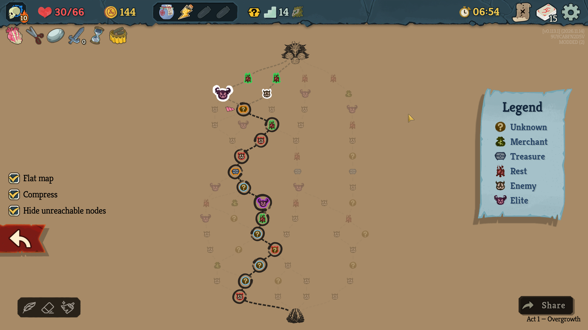

# One-Page Map & DeckView — Slay the Spire 2 Mods

Two independent, visual-only UI mods for **Slay the Spire 2** (`v0.113.1`). Install either one or
both — neither changes cards, routes, combat, rewards, saves, or any other gameplay, and neither
requires any other mods.

- **One-Page Map** — See the entire act map on one screen with no scrolling.
  [Steam Workshop](https://steamcommunity.com/sharedfiles/filedetails/?id=3776618284) · [Details](#one-page-map)
- **DeckView** — Zoom out deck screens to see more cards at once; hover to read full size.
  [Steam Workshop](https://steamcommunity.com/sharedfiles/filedetails/?id=3776619975) · [Details](#deckview)

---

## One-Page Map

**[Subscribe on Steam Workshop](https://steamcommunity.com/sharedfiles/filedetails/?id=3776618284)**



### What it does
- **Whole act at a glance:** Fits every floor from the start room to the boss (including two-boss
  acts) onto one screen so you can plan your full route without scrolling.
- **Easier-to-read icons:** Keeps the game's original room icons and adds colored outlines by room
  type so you can tell fights, elites, shops, rests, treasures, and `?` rooms apart at smaller
  scale.
- **Clear route cues:** Rooms you can travel to right now pulse with a white border (including
  relic effects like Wing Boots). Visited `?` rooms display the room type they turned out to be, and
  hovering an entry in the legend highlights all rooms of that type.
- **Everything from the vanilla map still works:** Legend, animated bosses, map drawing and
  erasing, quest markers, visited-room tooltips, ink circles, current-position marker, and
  multiplayer votes/cursors all work as normal.

### Options
Three checkboxes in the bottom-left corner let you customize the view (choices are remembered
between runs):

- **Flat map** *(on by default)* — Switches between the one-page view and the game's normal
  scrolling map whenever you want to compare or go back.
- **Compress** *(on by default)* — Smooths horizontal spacing and draws gentle curved paths so
  branches are cleaner and easier to trace, without changing which rooms connect or adding path
  crossings. Uncheck it to keep the game's original column positions with straight paths.
- **Hide unreachable nodes** *(off by default)* — Fades out rooms and paths you can no longer reach
  from your current position so only the routes still open to you stand out.

### Controls
- **M** or the top-bar map button — Open or close the map.
- **F** *(while the map is open)* — Flip between One-Page Map and the standard scrolling map.
- **ESC** / Back — Close the map.
- Works with mouse, keyboard, and controller.

---

## DeckView

**[Subscribe on Steam Workshop](https://steamcommunity.com/sharedfiles/filedetails/?id=3776619975)**


### What it does
- **See more of your deck at once:** Shrinks cards in deck-browsing screens so more rows and
  columns fit on screen without scrolling.
- **Full-size hover preview:** Hover over any shrunk card to enlarge it back to full size so card
  text stays easy to read.
- **Where it applies:** Deck view, draw / discard / exhaust piles, Card Library, and deck
  card-selection screens (such as Smith, Transform, Remove, Enchant, and pile selection).
- **What stays normal size:** Your combat hand, card inspect popup, card rewards, shop,
  choose-a-card screens, unlocks, and card bundles are left untouched.

### Options & controls
- **Mini-cards** checkbox *(on by default, remembered between runs)* — Shown at the bottom-left of
  every affected screen (and in the Card Library sidebar) to toggle between shrunk and normal card
  sizes at any time. Automatically hides when you peek at combat during card selection.
- **T** — Hotkey to toggle mini-cards on or off while viewing an affected screen (ignored while
  typing in search boxes).
- Works with mouse, keyboard, and controller.

---

## Install

### Steam Workshop *(recommended)*
1. Subscribe to [One-Page Map](https://steamcommunity.com/sharedfiles/filedetails/?id=3776618284)
   and/or [DeckView](https://steamcommunity.com/sharedfiles/filedetails/?id=3776619975).
2. Launch Slay the Spire 2 using **Play with Mods**.
3. Enable the mod(s) in the **Mods** menu and restart when prompted.

### Manual install
Download the release archive(s) from
[GitHub Releases](https://github.com/ernop/sts2-mods/releases) and extract into your game's `mods`
folder:

```text
Slay the Spire 2/
└── mods/
    ├── flatmap/
    │   ├── flatmap.dll
    │   └── flatmap.json
    └── deckview/
        ├── deckview.dll
        └── deckview.json
```

### Compatibility
Built and tested for **Slay the Spire 2 `v0.113.1`**. If a future game update changes something a
mod relies on, that mod detects the mismatch on startup, disables itself automatically, and leaves
the standard game UI intact until an updated build is released.

---

## For developers

Requires the .NET 9 SDK and an installed copy of Slay the Spire 2. Build and install both mods into
the local game directory with:

```powershell
.\scripts\build.ps1 -Install
```

See [`DEVELOPMENT.md`](DEVELOPMENT.md) for toolchain, decompilation, and safety checks,
[`docs/requirements.md`](docs/requirements.md) for the product specification, and
[`PUBLISHING.md`](PUBLISHING.md) for release packaging.

## License

MIT License ([LICENSE](LICENSE)). Slay the Spire 2 and its assets are owned by Mega Crit.
