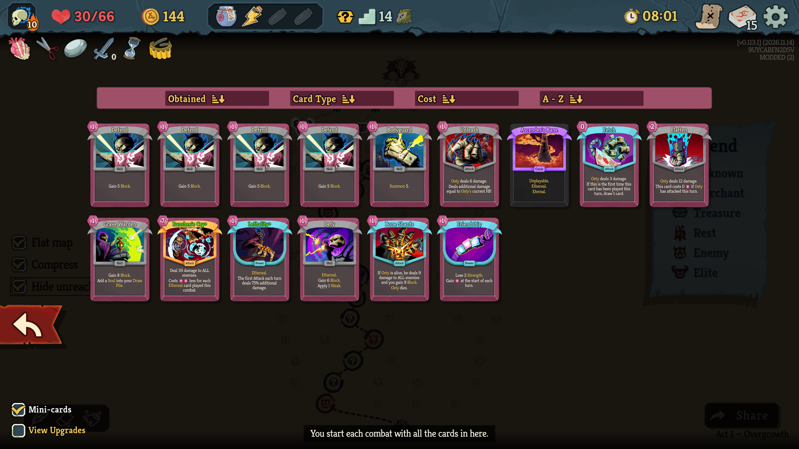

# FlatMap & DeckView — Slay the Spire 2 UI mods

This repository contains **two fully independent mods** for Slay the Spire 2 (each its own DLL,
manifest, config, and compatibility preflight — install either or both):

- **FlatMap** (`flatmap`) — a clearer, optional **whole-act map view**: the vanilla map's own
  vertical layout, compressed so every node of the act fits on one screen.
- **DeckView** (`deckview`) — **zoomed-out deck views**: shrinks deck-like screens so the whole
  deck is visible at a glance; hover pops a card back to full size.

Both change visibility and UI layout only: **they do not alter cards, routes, travel rules, saves,
combat, rewards, or any other gameplay.**

| Flat map page | Mini-cards deck view |
|---|---|
|  |  |

> **Compatibility target: Slay the Spire 2 `v0.113.1`.**
>
> Each mod checks every game hook, and every game member its compiled code calls, before
> enabling. If an STS2 update moves or changes a member,
> the mod logs the missing hooks, disables itself, and leaves the vanilla UI running. Harmony
> setup is rolled back if patching fails, so neither mod ever intentionally leaves a
> half-patched UI.

## FlatMap — the whole-act map

STS2's map is a tall vertical scroll: you can never see the whole act at once. FlatMap drives
the **real `NMapScreen` in place** — same orientation (start at the bottom, boss at the top),
same rooms, same connections, same native controls — compressed vertically so the **whole act
fits one screen**, with zero parallel capstone screen and zero node borrowing.

- **The game's own visual language & live nodes.** The background is the act's own map colour
  (`Act.MapBgColor`), connections are crisp **dashed footpaths** in the act's own path palette,
  and every room is the game's live `NMapPoint` node with opaque natural icon art and vivid
  room-type borders (Neon Rims). The original size language holds: **elites draw larger, the
  boss largest** (using the game's real animated Spine `NBossMapPoint` — and both bosses in
  two-boss acts). The **game's own Legend panel**, **map drawings** (`NMapDrawings` +
  `%DrawingTools`), **visited-room hover history**, **quest markers**, **ink circles**,
  **shop music**, and **multiplayer votes/pings/cursors** all stay 100% native.
- **State in motion, like the original.** Hovering any room swells it under the cursor; the rooms
  you can travel to *right now* carry white "next step" borders and pulse continuously at the
  vanilla map's rate (relic-aware incl. Wing Boots); hovering a legend row swells every room of
  that type via vanilla `HighlightPointType`. Your spot is marked by the game's own "you are
  here" arrow on the left side; your past route keeps its colours slightly dimmed (a visited `?`
  adopts the room it turned out to be) and vanilla run-seeded ink circles; optionally, rooms you
  can no longer reach fade to faint ghosts (the **Hide unreachable nodes** checkbox, off by
  default). Click a pulsing room to travel via the game's own selection path.
- **Three checkboxes** (bottom-left, saved across runs, staying above the Back button with a
  fixed "Flat map" position across modes): **Flat map** (flat vs. classic rendering),
  **Compress** (on by default — smooth continuous vertical-rail & curvature layout with rim-fanned
  curved dashed footpaths; off = exact 1:1 vanilla columns with straight paths — connectivity is
  never changed), and **Hide unreachable nodes** (off by default — on = rooms you can no longer
  reach fade to ghosts).
- **Standard controls always work natively:** the top-bar map button, the map room, **M** /
  **Tab**, ESC/back, and controller focus all run through vanilla `NMapScreen` untouched; **F**
  instantly flips flat↔classic in place while the map is open (and automatically reverts during
  map share screenshots).
- It only ever changes presentation and layout — it never mutates gameplay state.

**Smooth map layout (the interesting part).** The act fits on one screen without ever changing
which rooms connect. The key invariant: every floor preserves strict left-to-right column order
with `>= 1.0` lane separation, so the crossing count is identical to the game's and rooms can
never overlap or swap. When **Compress** is on (default), a continuous convex optimizer
(`ContinuousMapLayout` — pseudo-Huber vertical-rail pull + second-derivative curvature smoothing,
projected via exact PAV per floor with Start and Boss/SecondBoss aligned on one spine) straightens
chains, centers forks and merges, separates unlinked neighbors subtly, and draws smooth rim-fanned
cubic Bézier dashed footpaths at a calm aspect ratio on both 16:9 and ultrawide displays. Turn
**Compress** off anytime for exact 1:1 vanilla columns with straight dashed paths. Proven offline
in `layout/`: invariant checkers, metrics, 1,300+ random/fan/two-boss/smooth tests, and captured
real levels; a runtime invariant check refuses to draw an illegal layout.

Under the hood: FlatMap drives `NMapScreen` directly in place — placing and scaling the live
`NMapPoint` nodes, pinning `_mapContainer`, applying an exact affine transform to native
`Drawings` without touching `Drawings.Size`, and rendering flat backdrop, dashed paths, and
chrome through lightweight event-driven overlays.

## DeckView — the deck zoom

STS2 draws deck-like views at a size where only a handful of cards fit on screen. DeckView
(the direct heir of the STS1 mod of the same name) shrinks those cards so more of the deck fits
at once.

- **Shrinks:** the deck view, the draw / discard / exhaust piles, the card library, and the deck
  card-select screens — scoped strictly by an `NCardGrid` ownership allowlist (not a screen
  denylist).
- **Left at normal size:** the combat hand, the inspect popup, and the choose-a-card,
  card-reward, unlock, shop, card-bundle, and any other non-grid screens.
- **Unified single-owner hover:** hovering pops a card instantly to full size; moving off snaps
  it back cleanly through the game's own un-hover path (dismissing keyword tips & previews with
  zero flicker and zero stuck-big cards). Controller/keyboard navigation runs 100% vanilla.
- **Toggle any time:** the on-screen **Mini-cards** checkbox (present on deck view, draw/discard/
  exhaust piles, card library, and deck card-select screens — hidden with Peek when peeking) or
  **T** (guarded against text fields like Card Library search, modifiers, and modals). Persisted
  in `user://deckview.cfg`.

Under the hood: `NCardGrid` is already responsive — the column count, row count and scroll
bounds all derive from the per-card layout size (`_cardSize`) and `CardPadding` — so the mod
shrinks the layout cell and the rendered scale together and everything reflows. Tunables
(`CardScaleFactor` 0.6, `CardPadding` 24, `ToggleDeckModeKey` T) sit at the top of
`deckview/DeckViewMod.cs`.

## Requirements

- Slay the Spire 2 `v0.113.1`.
- No gameplay dependencies. Both mods use the game's built-in mod loader.

## Install

Download the archives you want from
[GitHub Releases](https://github.com/ernop/sts2-mods/releases), then extract into the game's
`mods` directory:

```text
Slay the Spire 2/
└── mods/
    ├── flatmap/
    │   ├── flatmap.dll
    │   └── flatmap.json
    └── deckview/
        ├── deckview.dll
        └── deckview.json
```

Launch STS2 using Steam's **Play with Mods** option, enable the mod(s) in the **Mods** menu,
and restart when prompted.

## Build from source

Building requires the .NET 9 SDK and an installed copy of STS2. Both projects reference the
game-provided `sts2.dll`, `GodotSharp.dll`, and `0Harmony.dll`; none are bundled.

```powershell
# from the repo root, on Windows — builds BOTH mods and installs them:
.\scripts\build.ps1 -Install
```

Or per mod: `dotnet build flatmap\flatmap.csproj -c Release -o flatmap\bin` /
`dotnet build deckview\deckview.csproj -c Release -o deckview\bin`, then copy each DLL +
manifest into `…\Slay the Spire 2\mods\<id>\`.

A/B check: launch with `--nomods` to see vanilla for comparison.

See [`DEVELOPMENT.md`](DEVELOPMENT.md) for the full dev setup — decompiling the game
(`ilspycmd`), the map data model, compatibility preflight, and release checks — and
[`docs/requirements.md`](docs/requirements.md) for the living product spec (including the
map-drawing design directives).

## Status / caveats

- Targets STS2 `v0.113.1`; `TestedGameVersion` in each mod and `min_game_version` in each
  manifest record that target. Build, hook, and in-game checks in `PUBLISHING.md` are release
  gates.
- Mouse, keyboard, and controller can activate every checkbox. On the flat map, controller
  focus starts on a legal destination; directional input moves between destinations and accept
  travels there.
- Both mods use private game members, so every STS2 update requires verification.
  `scripts/verify-hooks.sh` and each mod's in-game preflight maintain the complete hook
  inventory. Missing hooks disable the affected mod cleanly and preserve vanilla behavior.
- Full build and in-game checks require an installed copy of STS2 and cannot run in public CI.
- To support a newer game build: rebuild against its `sts2.dll`, then bump `TestedGameVersion`
  and each manifest's `min_game_version` / description.

## License

Available under the [MIT License](LICENSE). Slay the Spire 2 and its assets are owned by
Mega Crit. Repository screenshots depict the game UI; the install archives contain only each
mod's DLL and manifest.
